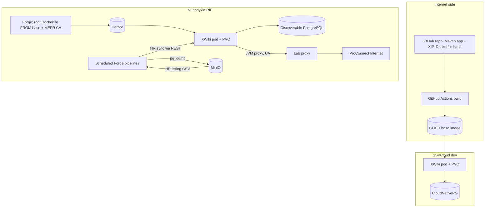
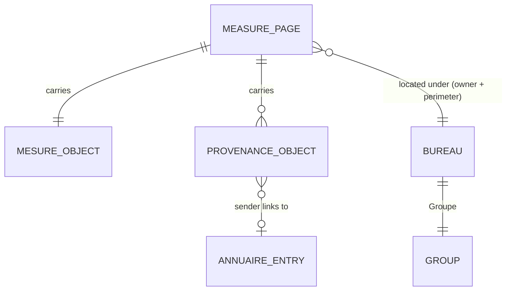

# Direction du Budget Knowledge Wiki - Plan

## Goal Capsule

- **Objective:** Agents in the pilot bureaux of the Direction du Budget find, in one place they trust, why each public-policy measure exists, how it can be changed, what documents back it, and where its figures come from, while each sector's material stays visible only to that sector and to the synthesis bureaux.
- **Means:** A self-hosted XWiki 17.10 LTS on Nubonyxia, packaged for a no-internet runtime, with the measure-sheet applications versioned in this repo (KTD1, KTD3).
- **Product authority:** The project lead at the Direction du Budget who requested this work. The Product Contract wins on behavior; KTDs win on mechanism.
- **Execution profile:** Platform feasibility first (U1), then the packaged wiki, then the applications and operations tooling. Development and acceptance testing run on SSPCloud with fictitious data only (R20).
- **Stop conditions:** Stop and return to the product authority if U1 shows that Nubonyxia can give XWiki neither a persistent volume nor a deployment path outside the platform template, or that ProConnect cannot be reached from the wiki's pod with any accepted `User-Agent`.
- **Who finishes:** The implementer delivers U1–U10. Opening the pilot requires the human steps in Operational / Rollout Notes: the hosting agreement, the HR listing feed, ProConnect client registration, and the champions' completion of their sheets.
- **Open blockers:** None for planning. Implementation from U3 onward depends on U1's findings (see Open Questions).

---

## Product Contract

### Summary

An XWiki on Nubonyxia whose core object is the measure sheet: one structured page per public-policy measure, covering its history, how to modify it, its documentation, and the provenance of its data.
Visibility follows the Direction's organisation: sector bureaux are walled off from each other, and synthesis bureaux see across all perimeters.
Procedure sheets, a budget glossary and a who-does-what directory support the measure sheets; several volunteer bureaux open it first, seeded by a bulk import that their champions complete.

### Problem Frame

Knowledge about measures is scattered across mailboxes, network drives, spreadsheets and individual memory, with no place where it is both accessible and ordered.
Three costs recur. Bureaux redo analyses another bureau has already done. Newcomers spend weeks rebuilding the history of a measure or procedure. Synthesis bureaux poll sector bureaux for answers that should already be written down.
The pain is broad and recognised across the Direction rather than tied to one triggering incident.

### Actors

- A1. Sector bureau agent: reads and edits their own bureau's measure sheets and reads the synthesis perimeter.
- A2. Synthesis bureau agent: reads every perimeter and edits their own bureau's sheets.
- A3. Bureau champion: named agent in each pilot bureau who drives completion of that bureau's sheets.
- A4. Central wiki administrator: manages bureau membership from the HR listing, runs imports, and holds the rights to run code in pages.
- A5. Newcomer: an A1 or A2 who has just joined a bureau and onboards from the wiki.
- A6. Nubonyxia platform team: hosts the production service under the hosting agreement.

### Key Decisions

- **Production runs on Nubonyxia under an explicit hosting agreement.** Governs R20, R23. (session-settled: user-directed — chosen over a Nubonyxia pilot followed by migration, or a separate ministry hosting: an agreement with the Nubonyxia team exists or will be obtained for a long-lived service.)
- **XWiki, self-hosted on the RIE.** Structured page types, forms, queryable lists and in-page scripting are the reason; the planned calculation engines depend on them. Governs R1, R22. (session-settled: user-directed — chosen over La Suite numérique Docs and Osmose/Resana: they lack structured applications and in-page computation.)
- **The pilot opens with several volunteer bureaux, each owning its own space.** Governs R11, R19. (session-settled: user-directed — chosen over a single pilot team, whole-Direction opening, or the requester's own team first.)
- **Visibility is set by a sheet's perimeter, not by its owner.** Governs R5–R9. (session-settled: user-directed — chosen over all sheets shared, private by default with opt-in publication, and field-level visibility: this mirrors how sector and synthesis bureaux already work.)
- **Agents sign in with ProConnect.** Governs R15. (session-settled: user-directed — chosen over local wiki accounts, direct connection to the ministry directory, and local accounts first with SSO later: no passwords to manage, and the route is already proven on Nubonyxia.)
- **A central administrator maintains bureau membership from an HR listing.** Governs R16. (session-settled: user-directed — chosen over champion-managed groups and yearly expiring membership: the perimeter walls are only as good as membership accuracy, and DB staff move between bureaux often.)
- **Sheets are seeded by bulk import, then completed by champions.** Governs R18, R19. (session-settled: user-directed — chosen over import alone and manual entry alone: an empty wiki is not adopted.)
- **Data provenance lives inside each measure sheet.** Governs R2. (session-settled: user-directed — chosen over shared data-flow pages referenced by measures, and a flow-first catalogue: simplest for bureaux; revisit when calculation engines arrive, accepting that reworking imported sheets then has a cost.)
- **Only agents in the HR listing get access; any other ProConnect user sees nothing.** Governs R6, R10, R17. (session-settled: user-directed — chosen over admitting any ProConnect user, and read-only access for outsiders: ProConnect federates agents from every administration, and the wiki is for the Direction du Budget.)
- **Synthesis bureaux do not see sector bureaux' private working spaces.** Their cross-perimeter view covers measure sheets only. Governs R11.
- **Default editing rights in the common area.** Each procedure sheet is edited by its owning bureau. Glossary entries are editable by any Direction agent. Each bureau edits its own who-does-what entry, and the administrator edits external contacts. Governs R10.

### Requirements

**Measure sheets**

- R1. Each measure sheet is a structured page that records the measure's identification, owning bureau, perimeter, creation (date and legal vehicle), rationale, how it can be modified, and its internal and external documentation.
- R2. Each measure sheet carries a structured data-provenance section stating, for each data item, who sends it, how often, in what form, and the contact; the sender links to its who-does-what entry when one exists.
- R3. Readers can list and filter measure sheets by owning bureau, perimeter and free text; results contain only sheets the reader is allowed to read.
- R4. Each measure sheet shows when it was last modified and by whom.

**Visibility and editing**

- R5. Every measure sheet belongs to exactly one perimeter: either the sector perimeter of its owning bureau (sector or synthesis) or the synthesis perimeter.
- R6. Synthesis-perimeter sheets are readable by every Direction agent, meaning a signed-in agent who appears in the HR listing.
- R7. A sector-perimeter sheet is readable only by members of its owning bureau and members of any synthesis bureau, including when the owning bureau is itself a synthesis bureau.
- R8. Only members of the owning bureau, and the administrator, can edit a measure sheet.
- R9. Search, listings, links, backlinks, notifications and activity feeds never reveal the title or content of a page the reader cannot read.
- R10. The common area (procedure sheets, glossary, who-does-what) is readable by every Direction agent.
- R11. Each bureau has a private space readable and editable only by its members.

The resulting read matrix for measure sheets (R6, R7):

| Reader | Own bureau's sector perimeter | Another bureau's sector perimeter | Synthesis perimeter |
|---|---|---|---|
| Sector bureau member | Read and edit | No access | Read; edit only if their bureau owns the sheet |
| Synthesis bureau member | Read and edit | Read | Read; edit only if their bureau owns the sheet |

**Supporting content**

- R12. Procedure sheets are structured pages recording purpose, steps, calendar, owning bureau, references and last review date, and can be listed and filtered.
- R13. Glossary entries record a term and its definition and can be linked from any page.
- R14. The who-does-what directory lists each bureau's missions, topics and referents by subject, plus external data senders, with professional contact details only.

**Identity and membership**

- R15. Agents sign in through ProConnect; agents have no wiki-specific password.
- R16. Bureau membership is maintained by the administrator from an HR listing on a regular schedule; whether each bureau is a sector or a synthesis bureau is set in the administrator's bureau registry. An agent who leaves a bureau loses access to that bureau's sector perimeter and private space at the next sync.
- R17. A Direction agent with no bureau membership can read only the common area and the synthesis perimeter. A signed-in user absent from the HR listing can read nothing.

**Seeding**

- R18. A bulk import creates skeleton measure sheets from existing lists, each with its owning bureau and perimeter set, so that R7 applies from the moment the sheet exists.
- R19. Each pilot bureau has a named champion responsible for completing an agreed set of its sheets before the pilot opens to the bureau's agents.

**Platform and operations**

- R20. Real content exists only on Nubonyxia; development and testing on SSPCloud use fictitious or public data only.
- R21. Every capability the wiki needs (ProConnect sign-in, structured page types, import) is packaged into the deployed version; production never installs extensions from the internet.
- R22. Only the administrator can save pages that run code; editors cannot.
- R23. Content (pages, attachments, history) is backed up regularly, and one full restore is rehearsed before the pilot opens.
- R24. The interface and page templates are in French.

### Key Flows

- F1. Look up a measure
  - **Trigger:** An agent needs the history or data source of a measure.
  - **Actors:** A1 or A2
  - **Steps:** The agent signs in with ProConnect, searches or filters the measure list, and opens the sheet; provenance names the sender and links to its who-does-what entry.
  - **Covered by:** R1, R2, R3, R9, R15
- F2. Answer a cross-cutting question
  - **Trigger:** A synthesis bureau needs the same information across several sector bureaux.
  - **Actors:** A2
  - **Steps:** The agent filters measure sheets across perimeters and reads them directly instead of polling the sector bureaux.
  - **Covered by:** R3, R7
- F3. An agent changes bureau
  - **Trigger:** The HR listing shows the agent in a new bureau.
  - **Actors:** A4, A1
  - **Steps:** At the next sync, the administrator's process moves the agent's membership; access to the old bureau's sector perimeter and private space ends, and access to the new one begins.
  - **Covered by:** R16, R7, R11
- F4. Seed a pilot bureau
  - **Trigger:** A bureau joins the pilot.
  - **Actors:** A4, A3
  - **Steps:** The administrator imports the bureau's existing list as skeleton sheets with owner and perimeter set; the champion completes the agreed set; the bureau's agents are then given access.
  - **Covered by:** R18, R19

### Acceptance Examples

- AE1. **Covers R7, R9.** **Given** sector bureau B owns a sector-perimeter sheet "Mesure X", **when** an agent of sector bureau A searches for "Mesure X", **then** no result, title or snippet appears.
- AE2. **Covers R7.** **Given** the same sheet, **when** an agent of any synthesis bureau opens it, **then** they can read it but not edit it.
- AE3. **Covers R6, R7.** **Given** synthesis bureau S owns one sheet in its own sector perimeter and one in the synthesis perimeter, **when** an agent of sector bureau A browses the list, **then** they see only the synthesis-perimeter sheet.
- AE4. **Covers R8.** **Given** a synthesis-perimeter sheet owned by bureau S, **when** an agent of sector bureau A opens it, **then** it is read-only for them.
- AE5. **Covers R9.** **Given** a sheet of bureau A links to a sector-perimeter sheet of bureau B, **when** another agent of A views it, **then** the link does not disclose B's sheet title.
- AE6. **Covers R16.** **Given** an agent moves from bureau A to bureau B in the HR listing, **when** the next sync has run, **then** they can no longer open A's sector-perimeter sheets or private space and can open B's.
- AE7. **Covers R17.** **Given** an agent in the HR listing signs in but belongs to no bureau, **when** they browse, **then** they see the common area and the synthesis perimeter only.
- AE9. **Covers R6, R17.** **Given** a ProConnect user absent from the HR listing signs in, **when** they browse or search, **then** they see no content.
- AE8. **Covers R22.** **Given** an editor who is not the administrator, **when** they save a page containing script code, **then** the code does not run.

### Success Criteria

At pilot kickoff, the project lead and the champions set a numeric target for each of the four signals below. The pilot is judged on all four about six months after opening:

- A target share of each pilot bureau's measures has a complete sheet.
- Newcomers in pilot bureaux onboard from the wiki rather than from scattered files.
- Synthesis bureaux answer cross-cutting questions from the wiki instead of polling sector bureaux.
- At least one shared drive or reference spreadsheet in a pilot bureau is retired in favour of the wiki.

### Scope Boundaries

**Deferred for later**

- Calculation engines embedded in pages that update cost estimates (*chiffrages*) automatically.
- Data flows as shared objects referenced by several measures.
- Opening to the whole Direction.
- Automatic sync with the ministry directory (LDAP/Active Directory).
- Field-level visibility within a single sheet.
- Switching sign-in to the RIE ProConnect servers once those flows open.

**Deferred to Follow-Up Work**

- Upgrade to the XWiki 18.10 LTS once released, rehearsed on SSPCloud first.
- Running the acceptance suite in CI against an ephemeral XWiki and PostgreSQL, instead of against the dev instance.

**Considered and not built**

- A cap on mass removals in the HR sync. A truncated listing would remove access, which agents notice immediately, and the next correct file restores it. File validation in U8 already blocks the silent failure mode (wrong bureau codes). Revisit if the feed proves unreliable.

**Outside this product's identity**

- Collaborative live drafting of documents, which La Suite numérique Docs already covers.
- Official records management or archiving of signed documents; the wiki links to them rather than holding the reference copy.

### Dependencies / Assumptions

- The Nubonyxia hosting agreement covers a long-lived service with persistent storage and regular backups, beyond the platform's usual lab status.
- An HR listing mapping agents to bureaux exists, and the administrator can receive it regularly. Not yet verified.
- Each pilot bureau has an existing list of its measures that can be imported.
- ProConnect sign-in from Nubonyxia goes through ProConnect Internet via the lab proxy, because flows to RIE ProConnect were closed as of October 2026. The proxy filters on `User-Agent`.
- Who-does-what holds professional contact details only, which keeps it within ordinary GDPR processing.

### Outstanding Questions

**For the product authority (not blocking implementation)**

- Measure sheets keep XWiki's default commenting, so any reader of a sheet can comment on it. If comments should follow edit rights (R8), that is a one-line rights change in U5.
- Numeric targets for the Success Criteria are set at pilot kickoff.

Planning-time questions from the brainstorm are resolved in the Planning Contract below. Execution-time unknowns are listed under Open Questions there.

### Sources / Research

- Onyxia platform guide (Nubonyxia and SSPCloud references, private repository `paquitopg/claude-onyxia-config`): deployment chain Forge → GitLab Runner → Harbor, secrets mounted as files, single-level ingress hostname, lab proxy `User-Agent` filtering, ProConnect per-platform clients, discoverable PostgreSQL.
- Prior Nubonyxia ProConnect integration: `PROCONNECT_DEPLOYMENT.md` in the private repository `opsonium-boostedCSVD`.
- Reference two-platform app: `nubonyxia/README.md`, `.gitlab-ci.yml`, `migration/run.sh` and `backend/app/settings.py` in the private repository `excel-addins-sample`.
- XWiki download page and release notes: 17.10.x is the current LTS (17.10.9, May 2026); 18.4.x is an intermediate LTS supported until end of 2026. https://www.xwiki.org/xwiki/bin/view/Main/Download
- XWiki offline installation via XIP packages and the Distribution Wizard: https://forum.xwiki.org/t/xip-13-9-for-offline-installation/9446 and https://playgroundtemplate.xwiki.org/xwiki/bin/view/FAQ/How%20to%20generate%20a%20XIP%20file%20for%20an%20Extension%3F
- OpenID Connect Authenticator (group claim and mapping settings): https://extensions.xwiki.org/xwiki/bin/view/Extension/OpenID%20Connect/OpenID%20Connect%20Authenticator/
- Attachment storage hints (`xwiki.store.attachment.hint=hibernate`, applies to new uploads only): https://playgroundtemplate.xwiki.org/xwiki/bin/view/Documentation/AdminGuide/Attachments
- REST XAR import known issues (XWIKI-20536, XWIKI-21071), which steer app deployment away from REST import: https://jira.xwiki.org/browse/XWIKI-20536

Product Contract preservation: changed R6, R10, R17 — access limited to agents in the HR listing (user decision after document review); R16 — bureau type comes from the registry, not the HR listing (wording fix, user-approved); AE9 added. Planning-deferred questions are resolved in place into the Planning Contract, and Sources were extended.

---

## Planning Contract

### Key Technical Decisions

- KTD1. **XWiki 17.10 LTS, from the official `xwiki:17.10-postgres-tomcat` image pinned by digest.** 17.10 is the current production-recommended line. The 18.4 intermediate LTS loses support at the end of 2026. The upgrade to the 18.10 LTS is follow-up work. Governs R1, R21.
- KTD2. **One base image, built on the internet side and reused unchanged on both platforms.** GitHub Actions builds the base image, which bundles everything XWiki would otherwise download, and pushes it to GHCR. SSPCloud runs it directly. On Nubonyxia, the root `Dockerfile` starts `FROM` that image by digest and adds only the ministry CA. The fallback transport, used if U1 shows the Forge build cannot pull from GHCR, is in Open Questions. Governs R20, R21.
- KTD3. **Every runtime extension ships in one XIP inside the image, and the container seeds it into the permanent directory.** The XIP holds the XWiki Standard flavor, the OpenID Connect Authenticator and this repo's application XAR. At startup, the entrypoint copies any repository entry missing from the permanent directory. `extension.repositories` is emptied so XWiki never calls out. A `wikidb-mainwiki` default-UI extension depends on the flavor, the authenticator and the application. `distribution.defaultUI` names it with its exact project version, and `distribution.job.interactive=false` installs or upgrades it, and with it everything it depends on, without the wizard. Applications are therefore versioned extensions, upgraded through the Extension Manager's merge rather than through REST XAR import, which has known history bugs. Governs R21.
- KTD4. **Attachments and their history are stored in PostgreSQL.** `xwiki.store.attachment.hint`, the versioning hint and the recycle-bin hint are all set to `hibernate` before any upload, because the hint only applies to new attachments. All user content then lives in one database, and a database dump is a complete content backup (R23). Governs R23.
- KTD5. **The permanent directory lives on a persistent volume.** XWiki records which extensions are installed in the permanent directory, not in the database. If the volume is lost, the flavor and the applications cannot simply be reinstalled over existing pages. U1 must confirm a volume is available on Nubonyxia, through the platform template or a Helm deployment. Without one, implementation stops (Goal Capsule). The search index also lives there and can be rebuilt. Governs R23.
- KTD6. **A measure sheet's perimeter is its location, not a field.** Sheets sit under `Mesures.<CodeBureau>.Secteur` or `Mesures.<CodeBureau>.Synthese`. Rights are set once per space, and changing a perimeter means moving the page. A stored perimeter field could then never disagree with the actual access rights. Governs R5–R8.
- KTD7. **Rights come from groups set at space level, and synthesis bureaux are reached through a nested group.** Each bureau has a group. A `GroupeDirection` group, maintained by the HR sync, holds every agent in the listing and carries the wiki-root rights. A `GroupeSynthese` group contains the synthesis bureaux' groups. XWiki implicitly denies a right to everyone not listed once any allow rule exists at a level. That turns the R7 matrix into two allow rules per sector space and one per bureau's synthesis space. Governs R6–R8, R10, R11, R17.
- KTD8. **Measure pages get neutral identifiers (`M-0042`) and carry the measure's name only as the page title.** XWiki may render a link to a page the reader cannot see using its page name. A neutral name keeps such a link from revealing the measure. Governs R9.
- KTD9. **ProConnect through the OpenID Connect Authenticator, with one client per platform.** The XWiki user name is derived deterministically from the ProConnect `email`, so the HR sync can compute the same user reference before an agent's first login. Group membership is never taken from ProConnect claims: ProConnect carries no bureau, and R16 assigns membership through the HR listing. A single local administrator account remains for emergencies. `superadmin` is disabled. Governs R15, R16.
- KTD10. **Outbound calls go through the lab proxy by explicit JVM settings, limited to the ProConnect hosts.** The JVM gets `https.proxyHost`/`https.proxyPort` set to the lab proxy, with `http.nonProxyHosts` covering the cluster and the internal RIE domains. The pod has no `https_proxy` variable, and the proxy filters on `User-Agent`, so `http.agent` is set to a value U1 confirms the proxy accepts. Governs R15.
- KTD11. **Secrets are read from the environment, otherwise from `/secrets/app/<NAME>`.** A small entrypoint wrapper fills the image's `DB_*` variables and the OIDC client secret from mounted files when the environment lacks them. The same image then runs with SSPCloud's `secretKeyRef` and Nubonyxia's file-mounted secrets (pattern: `backend/app/settings.py` in `excel-addins-sample`). Governs R20.
- KTD12. **Guests see nothing, and only administrators hold script and programming rights.** "Prevent unregistered users from viewing pages" is on. Guests are also denied the Register right, so no one can create a local password account. Local logins (break-glass and tooling accounts only) use XWiki's authentication failure strategy, which adds a captcha and then disables the account. Script right is denied to `GroupeDirection` and `XWikiAllGroup` at the wiki level. Application code pages and group pages are editable by administrators only (rights table). Application sheets are saved by an administrator, so their Velocity code runs with administrator rights while editors' pages cannot run code. Governs R22.
- KTD13. **Operations tooling is a small Python package that drives XWiki through its REST API.** `tools/wikidb` handles provisioning, HR sync, bulk import and the acceptance tests. Python matches the team's Onyxia tooling, the Nexus PyPI mirror is proven on Nubonyxia, and scheduled Forge pipelines already run Python jobs. The tooling authenticates as a dedicated local admin account, `wikidb-robot`, separate from the break-glass admin. Its password lives only in a masked, protected Forge variable or a runner-mounted secret. Governs R16, R18.
- KTD14. **The HR sync and backups run as scheduled Forge pipelines that read from and write to MinIO.** The scheduled-pipeline pattern is the one validated in `opsonium-boostedCSVD`. The administrator drops the HR listing (CSV: professional email, bureau code) into a MinIO bucket. Database dumps go to another bucket. Governs R16, R23.
- KTD16. **The GitHub repository is public and carries no RIE specifics; Nubonyxia deployment files live only in a private Forge project.** That project holds the root `Dockerfile` (FROM the public base image by digest, plus the ministry CA), `.gitlab-ci.yml`, the scheduled-job definitions and every RIE hostname, proxy address and Nexus URL. U1 records how it obtains the operations tooling. Governs R20. (session-settled: user-directed — chosen over a private repository holding everything, and a public repository holding everything: the base image and tooling stay publicly buildable while RIE details stay off the internet.)
- KTD15. **SSPCloud uses a small dedicated Helm chart (`k8s/wikidb`) instead of wrapping the `shiny` chart.** XWiki needs a persistent volume, slow-start probes and about 2 GiB of heap, which the generic chart is not built for. The same chart is reused on Nubonyxia if U1 shows Helm deployment works there. Governs R20, R23.

### High-Level Technical Design

Build and runtime topology. The flowchart shows the shape; the KTDs above are authoritative.



Content and rights layout (KTD6, KTD7). Each row is a space, and the rights are set on that space:

| Space | View | Edit |
|---|---|---|
| Wiki root | `GroupeDirection` (guests and unlisted users denied) | `GroupeDirection` where not restricted below; script right admins only |
| `Mesures.<B>.Secteur` | `Groupe<B>`, `GroupeSynthese` | `Groupe<B>` |
| `Mesures.<B>.Synthese` | inherited (all agents) | `Groupe<B>` |
| `Bureaux.<B>` (private) | `Groupe<B>` | `Groupe<B>` |
| `Procedures.<B>` | inherited | `Groupe<B>` |
| `Glossaire` | inherited | `GroupeDirection` |
| `Annuaire.Bureaux.<B>` | inherited | `Groupe<B>` |
| `Annuaire.Externes` | inherited | admins |
| `WikiDB` (registry, admin pages) | admins | admins |
| `XWiki` group pages (`Groupe*`) | inherited | admins |
| `Mesures.Code`, `Mesures.WebHome`, `Mesures.NouvelleMesure`, `Procedures.Code`, `Glossaire.Code`, `Annuaire.Code` | inherited | admins |

Measure data model:



`MESURE_OBJECT` holds the R1 fields: source key, creation date, legal vehicle, rationale, modification procedure, internal and external documentation. `PROVENANCE_OBJECT` holds the R2 fields: data item, sender, frequency, format, contact. A `BUREAU` registry entry holds a code, a name and a type (sector or synthesis).

### Output Structure

```text
.github/workflows/build-image.yml    # build XIP + base image, push GHCR
.gitlab-ci.yml                       # Nubonyxia: platform template + scheduled jobs
Dockerfile                           # Nubonyxia: FROM base digest + MEFR CA
xwiki/
  Dockerfile.base                    # official image + XIP + config + entrypoint
  pom.xml                            # parent: XWiki 17.10.x versions
  app/                               # XAR module: wiki applications (XML pages)
  xip/                               # XIP module: flavor + OIDC + app
  config/                            # xwiki.cfg / xwiki.properties overrides
  entrypoint-wikidb.sh               # secrets-from-files, repository seeding
k8s/wikidb/                          # Helm chart (SSPCloud; Nubonyxia if U1 allows)
nubonyxia/
  mefr-ca.crt
  feasibility.md                     # U1 findings
  scheduled.gitlab-ci.yml            # HR sync + backup jobs
tools/wikidb/                        # Python: client, provision, hrsync, importer, backup
tests/unit/
tests/acceptance/
docs/runbooks/                       # deploy, restore, add-a-bureau, HR feed, import
pyproject.toml
```

### Open Questions (execution-time)

- **Resolved by U1, blocking U3:** how the base image reaches Nubonyxia. The preferred route is a Forge build pulling from GHCR. If that fails, the fallbacks are Harbor proxy-caching GHCR, or committing the XIP through Git LFS and building the base image on the Forge.
- **Resolved by U1, blocking U3:** whether deployment uses the platform template (only if it supports a PVC, a long startup probe and about 3 GiB of memory) or `helm` from a Nubonyxia VSCode running with Role admin.
- **Resolved by U1, blocking U4:** a `User-Agent` value the proxy accepts on Java's `CONNECT` request to the ProConnect hosts. Java appends `Java/<version>` to `http.agent`, so the exact string must be tested.
- **Resolved by U1, blocking U10:** whether scheduled-job pods can reach the namespace's PostgreSQL service, and how the permanent directory is captured: a volume snapshot, a `kubectl exec` archive, or an image-and-database-only restore if U10 proves that path works.
- **During U8:** whether XWiki honors group membership for a user reference that does not exist yet, i.e. an agent who has never logged in. If it does not, the sync records pending members and applies them after the first login.

### Alternative Approaches Considered

- **Building everything on the Forge, without internet:** rejected as the primary route. Maven resolution of XWiki artifacts would need `maven.xwiki.org` mirrored on the Nexus, which is unverified. Only PyPI is proven there.
- **Deploying applications by REST XAR import or manual admin import:** rejected because of the documented history and deletion bugs, and because the result is neither versioned nor reproducible. The XIP extension route (KTD3) keeps upgrades mergeable.
- **A filesystem attachment store on the volume:** rejected. Backups would then need a consistent pair of database and filesystem, and losing the volume would lose content.

### Risks & Dependencies

| Risk | Mitigation |
|---|---|
| Nubonyxia offers no persistent volume for a long-lived app | U1 checks first, and the Goal Capsule makes this a stop condition |
| The proxy rejects the JVM's `User-Agent` | U1 tests from a JVM in a pod; the KTD10 setting; escalation to nubonyxia@finances.gouv.fr with test results |
| The offline flavor install misbehaves (known forum reports) | Exact version match between XIP and WAR, `distribution.job.interactive=false`, verified by a cold start in U2 |
| The HR listing has no professional emails, or arrives irregularly | KTD9 depends on email; U8 rejects malformed or stale files and alerts; a dependency for the pilot owner |
| HR listing emails differ from the emails ProConnect returns (aliases, homonyms, name changes) | U8 reports listed agents who never logged in and logged-in users in no bureau; check against the first pilot listing |
| The GitLab runner service is stopped, so scheduled jobs stay pending without failing | Each job records a last-success timestamp; the runbooks check it is under 48 hours old; the runner must stay running |
| Rights mistakes leak sector content | U5 acceptance suite covers AE1–AE9 and is rerun after every deployment |
| 17.10 support ends after 18.10 ships | Follow-up upgrade, rehearsed on SSPCloud first |
| The ministry CA expires in August 2027 | Recopy `nubonyxia/mefr-ca.crt` (onyxia guide) |

### System-Wide Impact

- **Auth boundary:** ProConnect becomes the wiki's only agent login. The break-glass admin and the test accounts on dev are the only local accounts.
- **Data lifecycle:** All content lives in one PostgreSQL database, and extension state lives on the volume. Backups cover both (U10).
- **Shared infrastructure:** The namespace on each platform gains a PostgreSQL instance, a PVC, MinIO buckets and a GitLab runner schedule.

### Operational / Rollout Notes

Human steps outside the implementer's reach, all needed before the pilot opens:

1. The hosting agreement with Nubonyxia covers the PVC, the memory and the long-lived service (Dependencies / Assumptions).
2. ProConnect client registrations: an integration client for SSPCloud dev, and a production client for Nubonyxia, since real agents can only sign in through production. Each needs its redirect URI. Start the production request early because it has its own lead time.
3. A regular HR listing feed into the MinIO bucket, with professional emails.
4. The bureau registry is filled (codes, names, sector or synthesis type), and a champion is named for each pilot bureau (R19).
5. The champions complete their imported sheets, and then the bureaux' groups are opened (F4).

---

## Implementation Units

### U1. Nubonyxia feasibility probe

**Goal:** Turn this plan's platform unknowns into recorded facts before any build or deployment work depends on them.

**Requirements:** R15, R20, R21, R23; Open Questions (execution-time)

**Dependencies:** None

**Files:**
- `nubonyxia/feasibility.md`
- `nubonyxia/probe/` (throwaway probe manifests and scripts, deleted once findings are recorded)

**Approach:**
1. From a Nubonyxia VSCode with Role admin, check `kubectl auth can-i` for deployments, PVCs and cronjobs, and list storage classes.
2. Run a Forge pipeline whose `Dockerfile` starts `FROM` a small public GHCR image, to check that the build can pull from GHCR. Do the same for Docker Hub's `xwiki:17.10-postgres-tomcat`.
3. Read the platform template's chart values, `nubonyxia-unified.gitlab-ci.yml` v3.1, for PVC, probe and resource settings.
4. From a JVM in a pod (the `xwiki` image itself), call both ProConnect integration's and production's discovery URLs through the lab proxy with several `http.agent` values, and record which pass.
5. From a scheduled-pipeline job pod, test a connection to the discoverable PostgreSQL and to MinIO.
6. Record each finding with its date, and the decision it settles in this plan's Open Questions.

**Execution note:** Exploratory. Prefer a working probe and a recorded observation over any production-shaped code.

**Patterns to follow:** The `User-Agent` comparison procedure and the scheduled-pipeline notes in the Onyxia Nubonyxia reference.

**Test expectation:** none -- this unit produces findings, not behavior.

**Verification:** `nubonyxia/feasibility.md` answers every "Resolved by U1" question with evidence. The Goal Capsule stop conditions are checked explicitly.

### U2. Packaged XWiki distribution

**Goal:** A base image that starts XWiki 17.10 in French on an empty database with no internet access, the flavor and applications installed automatically.

**Requirements:** R21, R24, R22; KTD1–KTD5, KTD11, KTD12

**Dependencies:** None (can run in parallel with U1)

**Files:**
- `xwiki/pom.xml`, `xwiki/app/pom.xml`, `xwiki/xip/pom.xml`
- `xwiki/app/src/main/resources/` (initially a placeholder `WikiDB.WebHome` page)
- `xwiki/Dockerfile.base`
- `xwiki/config/xwiki.cfg.overrides`, `xwiki/config/xwiki.properties.overrides`
- `xwiki/entrypoint-wikidb.sh`
- `.github/workflows/build-image.yml`
- `tests/unit/test_entrypoint.sh` (bats or plain shell assertions)
- `docs/runbooks/editing-wiki-apps.md`

**Approach:**
1. Set up a Maven parent pinned to the 17.10.x platform version, an `app` module with XAR packaging, and an `xip` module. The `xip` module defines the `wikidb-mainwiki` default-UI extension (KTD3) and bundles its dependency tree. The build writes `distribution.defaultUI=<groupId>:wikidb-mainwiki/<project version>` into the properties overrides.
2. `Dockerfile.base` starts from the pinned official image, unpacks the XIP into an image-side repository directory, adds the config overrides and wraps the entrypoint.
3. The entrypoint maps `/secrets/app/<NAME>` to the variables the image expects when they are unset (KTD11), copies missing repository entries into the permanent directory (KTD3), and then hands over to the official entrypoint.
4. The config covers: empty `extension.repositories`, non-interactive distribution, the hibernate attachment hints (KTD4), French as default language, no guest view (KTD12), `superadmin` disabled.
5. The workflow builds on pushes to `main` and tags the image by commit SHA plus `latest`. The GHCR package is made public; it contains nothing sensitive.

**Patterns to follow:** The GHCR workflow in the Onyxia SSPCloud reference. The XWiki contrib conventions for XAR modules (`xar:format`).

**Test scenarios:**
- With `DB_PASSWORD` unset and `/secrets/app/DB_PASSWORD` present, the entrypoint exports the file's value without a trailing newline.
- With `DB_PASSWORD` set in the environment, the file is ignored.
- With an empty permanent directory, all bundled repository entries are copied. On a second start, nothing already present is overwritten.
- Cold start with no network egress and an empty database: XWiki reaches a logged-out login page in French, and the logs show no attempt to install from a remote repository.
- After an image rebuild with a newer `app` version, the next start upgrades the application non-interactively.

**Verification:** The no-egress cold start passes on SSPCloud (network policy or a pod without the proxy), and the image digest is published.

### U3. Deployments on SSPCloud and Nubonyxia

**Goal:** Reproducible deployment of the base image with PostgreSQL and a persistent volume, on SSPCloud for development and on Nubonyxia for production.

**Requirements:** R20, R21, R23; KTD2, KTD5, KTD11, KTD15

**Dependencies:** U1, U2

**Files:**
- `k8s/wikidb/Chart.yaml`, `k8s/wikidb/values.yaml`, `k8s/wikidb/values-sspcloud.yaml`, `k8s/wikidb/templates/`
- `Dockerfile` (root, Nubonyxia), `.gitlab-ci.yml`, `nubonyxia/mefr-ca.crt`
- `k8s/wikidb/values-nubonyxia.yaml` (only if U1 selects Helm on Nubonyxia)
- `docs/runbooks/deploy.md`

**Approach:**
1. The chart defines a single-replica `Recreate` deployment (XWiki is not clustered here), a PVC for the permanent directory, a service, and an ingress (`ingressClassName: onyxia` on SSPCloud, no `secretName`). It sets a startup probe allowing at least 5 minutes, plus resources and JVM options.
2. SSPCloud uses a dedicated CloudNativePG instance from the catalog. The `-app` Secret is wired through `secretKeyRef`.
3. On Nubonyxia, the root `Dockerfile` adds the ministry CA to the system store and the JVM truststore. The Nubonyxia deploy path is the one U1 selected. The ingress hostname has a single level under the lab domain (exact value in the Forge project, KTD16). Secrets arrive as files.
4. The deploy runbook covers first install, upgrade by digest and rollback.

**Execution note:** Mostly packaging and configuration. Prove it with a deploy and smoke check on each platform rather than unit tests.

**Patterns to follow:** The Helm commands and the `helm template | kubectl apply --dry-run=server` check in the SSPCloud reference. The `.gitlab-ci.yml` and hostname rules in the Nubonyxia reference.

**Test scenarios:**
- `helm template` renders and passes a server-side dry run against the SSPCloud namespace.
- After a pod deletion, the new pod starts on the same volume and the installed extensions are unchanged (no reinstall in logs).
- An uploaded attachment's bytes are in PostgreSQL: the attachment content table is populated and no attachment file exists under the permanent directory. After a pod deletion, the attachment still downloads. This proves KTD4. Volume-loss restore is left to U10.

**Verification:** The wiki answers over HTTPS at its ingress on both platforms, and the restart test passes.

### U4. ProConnect sign-in and baseline security

**Goal:** Agents sign in with ProConnect on both platforms, guests see nothing, and only administrators can run code in pages.

**Requirements:** R15, R22, R17 (wiki-level part); KTD9, KTD10, KTD12; AE8

**Dependencies:** U1 (proxy findings), U3

**Files:**
- `xwiki/config/xwiki.properties.overrides` (OIDC block, per-platform values via environment)
- `k8s/wikidb/values-*.yaml` (OIDC endpoints, client ID, proxy JVM options)
- `xwiki/app/src/main/resources/` (wiki-level rights preferences page)
- `tests/acceptance/test_baseline_security.py`
- `docs/runbooks/proconnect.md`

**Approach:**
1. Set the OIDC endpoints from ProConnect discovery: scopes `openid email given_name usual_name`; first name from `given_name`, last name from `usual_name`; the user-name formatter derived from the cleaned email (KTD9); logout through ProConnect's end-session endpoint.
2. Set the JVM proxy and `User-Agent` options from U1's findings (KTD10). Plain HTTP within the cluster bypasses the proxy.
3. Wiki-level rights in the application XAR: deny script right to `GroupeDirection` and `XWikiAllGroup`; administrators only for programming right; deny guest view and the guest Register right; enable the authentication failure strategy (KTD12).
4. Bootstrap the administrators. The first start runs with a superadmin password read from a Secret. That session creates the break-glass admin and `wikidb-robot` (KTD13). A redeploy then disables superadmin. Passwords live in Secrets or masked CI variables and never in Git. The procedure goes in `docs/runbooks/deploy.md`.

**Patterns to follow:** The ProConnect per-platform client rules and `PROCONNECT_DEPLOYMENT.md` from `opsonium-boostedCSVD`.

**Test scenarios:**
- An anonymous GET on a content page redirects to login and never returns page content.
- An anonymous REST GET on `/rest/wikis/xwiki/spaces` returns no spaces or a 401.
- An anonymous GET or POST on the registration page is refused and creates no user.
- After the bootstrap redeploy, logging in as superadmin fails.
- Covers AE8. A non-admin test user saves a page containing a Velocity snippet; viewing it shows the code unexecuted or a script-right error, never its output.
- A first ProConnect login on dev creates a user whose page name matches the formatter applied to the login email (manual check, recorded in the runbook).
- The integration test in `tests/acceptance/` uses local test accounts over basic auth on dev, and that path still works while OIDC is enabled.

**Verification:** A real ProConnect login succeeds on SSPCloud dev and on Nubonyxia, and the baseline security tests pass on dev.

### U5. Bureau registry, provisioning and rights

**Goal:** Adding a bureau to the registry creates its group, spaces and rights so that the R7 visibility matrix holds, with an automated acceptance suite to prove it.

**Requirements:** R5–R11, R17; KTD6, KTD7, KTD8, KTD13; AE1–AE7

**Dependencies:** U4

**Files:**
- `xwiki/app/src/main/resources/WikiDB/Code/BureauClass.xml` (registry class), `WikiDB/Bureaux.xml` (registry listing)
- `tools/wikidb/client.py` (REST client), `tools/wikidb/provision.py`
- `tests/unit/test_provision.py`
- `tests/acceptance/conftest.py` (fictitious bureaux S1 synthesis, A and B sector; test users per bureau and one without a bureau)
- `tests/acceptance/test_visibility.py`
- `docs/runbooks/add-a-bureau.md`
- `pyproject.toml`

**Approach:**
1. The registry entry holds a code, a name and a type.
2. `provision` reads the registry and makes the target state true, idempotently: `Groupe<B>`; membership of synthesis groups in `GroupeSynthese`; the spaces and rights in the High-Level Technical Design table.
3. It reports, but never deletes, spaces of bureaux missing from the registry.
4. A change of bureau type moves its group in or out of `GroupeSynthese` on the next run.

**Patterns to follow:** None in the repo yet; this unit sets the REST-client pattern for U6–U9.

**Test scenarios:**
- Running `provision` twice produces no changes on the second run (unit, against a recorded or fake REST layer).
- A bureau switched from sector to synthesis gains view on another bureau's sector space after the next run.
- Covers AE1. A user of A searches (Solr) and lists (LiveData) for a term in B's sector sheet and gets no hit, title or snippet.
- Covers AE2. A user of S1 can GET B's sector sheet, and a PUT to it is refused.
- Covers AE3. A user of A sees S1's synthesis-perimeter sheet, but not S1's sector-perimeter sheet.
- Covers AE4. A user of A gets 403 when editing S1's synthesis-perimeter sheet.
- Covers AE5. B's sector sheet is linked from an A page; another A user's rendered page does not contain B's sheet title, and its backlinks and notifications show nothing from B.
- Covers AE7. A listed user with no bureau sees the common area and the synthesis spaces only.
- Covers AE9. A user absent from `GroupeDirection` gets no content from page views, search or REST.
- A non-admin user's attempt to add themselves to `GroupeSynthese` is refused, and so is an edit to the measure application's sheet code.
- A user of A cannot read `Bureaux.B` or B's sector space through REST, the attachment download URL or the page's history URL.

**Verification:** The full acceptance suite passes on dev with the fictitious bureaux.

### U6. Measure sheet application

**Goal:** A bureau can create, fill, list and filter measure sheets with the R1 fields and a structured provenance section.

**Requirements:** R1–R4, R8; KTD6, KTD8; F1, F2; Success Criteria (completeness share)

**Dependencies:** U5

**Files:**
- `xwiki/app/src/main/resources/Mesures/Code/MesureClass.xml` (bound to the sheet), `MesureSheet.xml`, `ProvenanceClass.xml`, `MesureMacros.xml` (completeness, place and registry macros shared by the pages)
- `xwiki/app/src/main/resources/Mesures/NouvelleMesure.xml` (creation form; no template page, the form creates the object)
- `xwiki/app/src/main/resources/Mesures/WebHome.xml` (LiveData listing)
- `tools/wikidb/measures.py` (`is_complete`, `completeness`; `wikidb completeness` reports the direction-wide share)
- `tests/acceptance/test_measures.py`, `tests/unit/test_measures.py`

**Approach:**
1. The creation form asks for a bureau (limited to the creator's bureaux) and a perimeter. It allocates the next `M-NNNN` identifier and creates the page in the matching space (KTD6, KTD8).
2. The sheet shows the R1 fields, a repeatable provenance block whose sender can link to an `Annuaire` entry, the last modification (R4), and the derived owner and perimeter.
3. The listing filters by bureau, perimeter and text, through XWiki's rights-filtered LiveData.
4. A computed "complete" indicator (all R1 fields and at least one provenance block filled) feeds the completeness success criterion.

**Patterns to follow:** XWiki AppWithinMinutes-generated class, sheet and template structure, refined by hand and exported to the `app` module.

**Test scenarios:**
- Creating a sheet as a bureau A user puts it under `Mesures.A.Secteur` (or `.Synthese`) with an `M-` page name and the given title.
- Two concurrent creations get distinct identifiers.
- A sheet with two provenance blocks shows both. A block whose sender links to an `Annuaire` entry renders a working link.
- The listing filtered on bureau A, viewed by a user of A, returns only A's sheets plus synthesis-perimeter sheets.
- The completeness indicator flips to complete only when every R1 field and at least one provenance block are filled.
- A user of A cannot create a sheet under bureau B.

**Verification:** The tests pass on dev. Editing the application on dev and exporting it reproduces the committed XML without spurious diffs (`xar:format`).

### U7. Procedures, glossary and who-does-what

**Goal:** The common area holds structured procedure sheets, a linkable glossary and a who-does-what directory, all in French.

**Requirements:** R10, R12, R13, R14, R24; KTD7

**Dependencies:** U5

**Files:**
- `xwiki/app/src/main/resources/Procedures/Code/`, `Glossaire/Code/`, `Annuaire/Code/` (classes, sheets, templates, listings)
- `tests/acceptance/test_common_area.py`

**Approach:**
1. Procedure sheets carry the R12 fields, sit under `Procedures.<B>` and have a listing.
2. Glossary entries are a class with a term and a definition, plus a lightweight way to link a term from any page (an XWiki link to the entry; no auto-linking).
3. The directory has bureau entries (missions, topics, referents by subject) under `Annuaire.Bureaux.<B>` and external senders under `Annuaire.Externes`, with professional fields only (R14).

**Test scenarios:**
- A user of A edits A's procedure sheet; a user of B gets 403 editing it but can read it.
- Any user in `GroupeDirection` can create and edit a glossary entry.
- A non-admin user gets 403 creating a page under `Annuaire.Externes`.
- The external-sender form offers no field for personal (non-professional) contact data.
- The glossary and procedure listings render French labels.

**Verification:** The tests pass on dev, and a champion-level walkthrough of the three applications is recorded in the add-a-bureau runbook.

### U8. HR membership sync

**Goal:** Bureau group membership follows the HR listing daily, so agents who move lose their old bureau's access at the next sync.

**Requirements:** R16, R17; KTD9, KTD13, KTD14; F3; AE6

**Dependencies:** U5, U1 (scheduled-job reachability)

**Files:**
- `tools/wikidb/hrsync.py`
- `nubonyxia/scheduled.gitlab-ci.yml` (HR sync job)
- `tests/unit/test_hrsync.py`
- `tests/acceptance/test_membership.py`
- `docs/runbooks/hr-feed.md`

**Approach:**
1. Read the newest listing from the MinIO bucket and validate it: not older than a configured maximum age, required columns, well-formed emails, every bureau code in the registry.
2. Reject the whole file on any validation failure, leave membership unchanged and fail the job visibly.
3. Compute user references with the KTD9 formatter, diff them against current `GroupeDirection` and `Groupe<B>` members, and apply additions and removals.
4. Write a run summary to the job log and to an admin-only page. It records counts, unknown codes and duplicates. It lists listed agents who have not logged in after 14 days and logged-in users who are in no bureau. It ends with a last-success timestamp, which the HR-feed runbook checks is under 48 hours old.

**Patterns to follow:** `nubonyxia/synchro-annuaire.gitlab-ci.yml` from `opsonium-boostedCSVD`: conditional includes for scheduled pipelines, Nexus pip with the concatenated CA bundle, durable MinIO keys in masked CI variables.

**Test scenarios:**
- A listing moving one agent from A to B removes them from `GroupeA` and adds them to `GroupeB`, leaving everyone else untouched.
- A listing with an unknown bureau code is rejected, and no membership changes.
- A listing with a missing column or an empty body is rejected.
- A newest listing older than the configured maximum age is rejected, and membership is unchanged.
- The run summary lists a listed email whose user has not logged in after 14 days, and a logged-in user in no bureau.
- The same email appearing twice with different bureaux is rejected and reported.
- An email with uppercase letters and dots maps to the same reference the OIDC formatter produces.
- Covers AE6. After a sync moving a test user from A to B, that user can no longer read A's sector sheet and can read B's.
- Covers AE9. A user removed from the listing leaves `GroupeDirection` and every bureau group at the next sync, and then sees no content.
- An agent in the listing who has never logged in can read their bureau's sector space right after their first ProConnect login (or after the next sync, per the U8 open question).

**Verification:** The unit tests pass, and the scheduled job runs green on Nubonyxia against a test listing.

### U9. Bulk import of measure lists

**Goal:** The administrator turns a bureau's existing list of measures into skeleton sheets with the right owner and perimeter, safely and repeatably.

**Requirements:** R18; KTD6, KTD8, KTD13; F4

**Dependencies:** U6

**Files:**
- `tools/wikidb/importer.py`
- `tests/unit/test_importer.py`
- `docs/runbooks/import-measures.md` (input template: bureau code, perimeter, title, source key, optional R1 fields)

**Approach:**
1. Read CSV or XLSX and validate every row before writing anything.
2. Create each sheet through the same placement rule as the creation form (KTD6).
3. Use the source key as an idempotency key, so a re-run updates empty fields of existing sheets but never overwrites fields a champion filled.
4. Default to a dry run, which prints what would be created or updated.

**Test scenarios:**
- A file of three valid rows creates three sheets in the right spaces with `M-` names.
- Re-running the same file creates nothing new.
- Re-running after a champion filled a field leaves that field unchanged.
- A row with an unknown bureau code or perimeter fails validation, and nothing is written.
- A dry run writes nothing and lists the planned actions.
- Accented titles and an XLSX with merged header cells are read correctly.

**Verification:** Unit tests pass, and a dev import of a fictitious list is checked against the visibility suite.

### U10. Backups and restore rehearsal

**Goal:** Wiki content is backed up nightly and can be restored to a working wiki, proven once before the pilot opens.

**Requirements:** R23; KTD4, KTD5, KTD14

**Dependencies:** U3, U5, U1

**Files:**
- `nubonyxia/scheduled.gitlab-ci.yml` (backup job)
- `tools/wikidb/backup.py` (dump, upload, retention pruning)
- `tests/unit/test_backup.py`
- `docs/runbooks/restore.md`

**Approach:**
1. The nightly job runs `pg_dump` in custom format, uploads it to the MinIO backup bucket and prunes by retention (daily for 14 days, weekly for 8 weeks). The permanent directory is captured by the method U1 selected. Each successful run writes a last-success marker next to the dumps, and the restore runbook checks it is under 48 hours old.
2. The restore runbook rebuilds the wiki from an empty namespace: database restore, volume restore or regeneration, then deployment.
3. The rehearsal is run once on SSPCloud with fictitious content and recorded.

**Test scenarios:**
- Retention pruning keeps the 14 newest dailies plus one per week for 8 weeks, and deletes the rest (unit, with fake object listings).
- A failed `pg_dump` makes the job fail and uploads nothing partial.
- A restore rehearsal on dev keeps pages, attachments, page history and group membership, and the visibility acceptance suite passes on the restored wiki.

**Verification:** One nightly backup lands in MinIO on Nubonyxia, and the recorded rehearsal shows a passing visibility suite after restore.

---

## Verification Contract

| Gate | Command / check | Applies to |
|---|---|---|
| Python unit tests | `pytest tests/unit` | U5, U8, U9, U10 |
| Entrypoint tests | `tests/unit/test_entrypoint.sh` | U2 |
| Wiki app build | `mvn -f xwiki/pom.xml package` and `mvn -f xwiki/pom.xml xar:verify` (formatted XML) | U2, U4–U7 |
| Chart render | `helm template wikidb k8s/wikidb -f k8s/wikidb/values-sspcloud.yaml \| kubectl apply --dry-run=server -f -` | U3 |
| Acceptance suite on dev | `pytest tests/acceptance --base-url <dev ingress>` with the fictitious bureaux | U4–U9; rerun after every deployment |
| Offline cold start | Fresh namespace without egress reaches the French login page | U2, U3 |
| Restore rehearsal | `docs/runbooks/restore.md` executed, acceptance suite green afterwards | U10 |

Acceptance tests never run against Nubonyxia production data. On Nubonyxia, verification is a smoke check: login, one sheet visible as expected for the operator's own bureau.

## Definition of Done

- Every unit's Verification is met, and the gates above pass for the units touched.
- `nubonyxia/feasibility.md` answers all U1 questions, and no stop condition fired, or the product authority accepted the fallback.
- AE1–AE9 each have a passing automated test on dev.
- The runbooks exist for deploy, ProConnect, adding a bureau, the HR feed, import, editing wiki apps and restore.
- No secret in Git, `values*.yaml` or logs. Probe artifacts from U1 and abandoned experiments are removed from the tree.
- The Operational / Rollout Notes list is handed to the product authority with each item's status.
