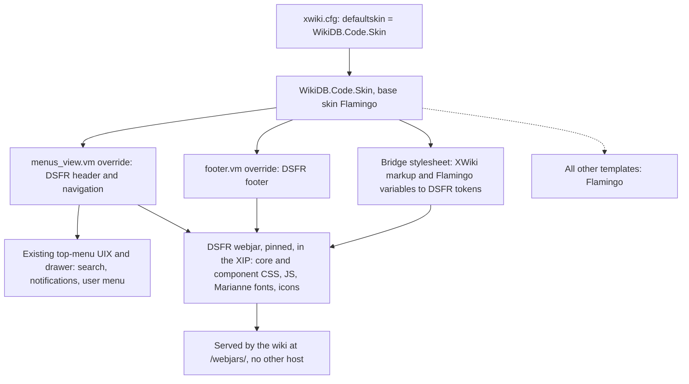

# DSFR Appearance for the Wiki - Plan

## Goal Capsule

- **Objective:** An agent who opens the wiki recognises a Direction du Budget service: the State header and footer, the Marianne typeface and the DSFR colours and components, on every page they read, on both platforms.
- **Means:** A WikiDB skin that inherits Flamingo, overrides only its header and footer templates, and loads the official DSFR files bundled offline in the XIP (KTD1, KTD2, KTD3).
- **Product authority:** The project lead at the Direction du Budget, as for `docs/plans/2026-10-14-1629-feat-direction-budget-wiki-plan.md`. The Product Contract wins on behavior; KTDs win on mechanism.
- **Execution profile:** Bundle the DSFR first (U1), then the skin's header and footer (U2), then the bridge stylesheet (U3) and the footer's mandatory pages (U4). Development and visual checks run on SSPCloud with fictitious data only.
- **Stop conditions:** Stop and return to the product authority if the Direction's communication service or the SIG refuses DSFR use for this internal service, or if XWiki cannot serve the bundled DSFR files without an internet call.
- **Who finishes:** The implementer delivers U1–U5. The bloc-marque wording, the legal and accessibility text, and any SIG approval come from the product authority (Open Questions).
- **Open blockers:** None for implementation. The bloc-marque wording must be settled before the pilot opens.

---

## Product Contract

### Summary

The wiki takes the DSFR look: the State header with the Marianne bloc-marque and "Direction du Budget", the DSFR footer, the Marianne font, and DSFR colours, buttons, forms, alerts and tables.
Pages agents read every day follow the DSFR fully; XWiki's editor and administration screens pick up its colours and font only.
Every DSFR file ships inside the image, so the wiki looks the same on Nubonyxia, which has no internet.

### Problem Frame

The wiki still shows stock XWiki (Flamingo skin).
Agents expect a State service to look like the other administration sites they use, and DSFR use is required for State websites and applications since July 2023 (circular 6411-SG).
An unfamiliar look costs trust at the moment the pilot asks bureaux to move their knowledge into the wiki.

### Requirements

**Look and brand**
- R1. Every page shows the DSFR header: the Marianne bloc-marque with the ministry wording, the service title "Direction du Budget", and the main navigation to Mesures, Procédures, Glossaire, Annuaire and Modèles.
- R2. Every page shows the DSFR footer with its mandatory links: accessibility status, legal notice and personal data.
- R3. Text uses the Marianne font, and colours, buttons, links, form fields, alerts, tables and breadcrumbs follow the DSFR on reading pages (home, measure sheets, procedures, glossary, directory, templates, login).
- R4. XWiki's editor and administration screens use the DSFR colours and the Marianne font, keeping their XWiki layout.

**Keep what works**
- R5. Search, the user menu with sign-out, notifications, page actions (edit, create) and the administrator's access to Administration remain reachable from every page.
- R6. The header, footer and navigation are in French and keep the DSFR's accessible markup: skip links, landmarks and the mobile menu.

**Offline and pinned**
- R7. Every DSFR file (CSS, JavaScript, fonts, icons) is served by the wiki itself, at one pinned DSFR version; no page loads a resource from another host.

### Key Decisions

- **Restyle XWiki's existing interface with the official DSFR files rather than rebuild it.** Governs R3, R4. (session-settled: user-approved — chosen over a new interface built from scratch: reading pages get the full DSFR, while editor and administration screens get colours and font only, because rebuilding them is a much larger project.)
- **The DSFR ships inside the image at a fixed version and never loads from the internet.** Governs R7. (session-settled: user-approved — chosen over loading it from a CDN: Nubonyxia has no internet, and both platforms must look the same.)
- **The light theme only.** Governs R3. (session-settled: user-approved — chosen over also shipping the DSFR dark mode.)

### Success Criteria

- An agent from a pilot bureau, shown the home page and a measure sheet, identifies it as a State service of the Direction du Budget.
- On a 360 px wide screen, the header collapses into the DSFR mobile menu and every R5 action stays reachable.

### Scope Boundaries

- No new features, content structure or rights changes.
- No rebuild of XWiki's editors (WYSIWYG, object editor) or administration screens beyond colours and font (R4).
- No DSFR dark mode, and no colour-scheme switcher in the footer.
- No formal RGAA audit; the footer states "Accessibilité : non conforme" until one is done (U4).
- Word and PowerPoint exports keep their current layout; the DSFR is a web design system.

#### Deferred to Follow-Up Work

- Rewriting sheet markup (measure, procedure, glossary sheets) into native DSFR components. U3's bridge stylesheet restyles the existing XWiki markup instead.

#### Considered and not built

- A switch to turn the DSFR brand off on the SSPCloud dev wiki. Dev is access-restricted and holds fictitious data, and the implementer needs to see the real look there; revisit if the product authority's check with the SIG says otherwise (Risks).

### Outstanding Questions

- Q1 (blocking the pilot, not implementation). The exact bloc-marque wording, meaning the ministry lines under "République française". Ministry names change with governments, so the product authority confirms the current wording with the Direction's communication service. U2 starts with the current ministry name.
- Q2 (blocking the pilot, not implementation). Who writes the legal notice and personal data text, and whether this internal service needs the SIG's approval (agrément) under the DSFR terms of use, articles 46–48.

### Sources / Research

- DSFR npm package `@gouvfr/dsfr`, licence Etalab 2.0 with usage terms in `doc/legal/cgu.md`. Versions: 1.15.4 (2026-10-12), 1.15.3 (2026-09-09), 1.14.4 (2026-03-03).
- DSFR terms of use: reserved to State services on `.gouv.fr` domains (art. 7, 14); the "Marianne" typefaces have their own terms of use (art. 20); new State sites need SIG approval (art. 46–48). Source: `doc/legal/cgu.md` in the npm package, and https://www.systeme-de-design.gouv.fr.
- Maven Central webjar `org.webjars.npm:gouvfr__dsfr` exists up to 1.13.0 (January 2025) only.
- Flamingo 17.10 templates: `menus_view.vm` renders the top bar through the `org.xwiki.platform.topmenu.left` and `org.xwiki.platform.topmenu.right` UI extension points plus `drawer.vm`; `footer.vm` renders `#footerglobal`; `cssVariablesInit.css` defines the skin's CSS variables (xwiki-platform, tag `xwiki-platform-17.10.0`, path `xwiki-platform-core/xwiki-platform-flamingo/xwiki-platform-flamingo-skin/xwiki-platform-flamingo-skin-resources/src/main/resources/flamingo/`).
- No existing XWiki DSFR skin was found.

---

## Planning Contract

### Key Technical Decisions

- KTD1. **A WikiDB skin document inherits Flamingo and is the wiki's default skin.** `WikiDB.Code.Skin` carries an `XWiki.XWikiSkins` object with Flamingo as base skin, so every template it does not override falls back to Flamingo. It is made the default through `xwiki.defaultskin` in `xwiki/config/xwiki.cfg.overrides`, like the other platform settings (KTD3 of the wiki plan). It ships in the application XAR, so upgrades follow the Extension Manager path already in place. Governs R1–R4.
- KTD2. **The DSFR comes in as a webjar from Maven Central, pinned to 1.15.3, and rides in the XIP like every other extension.** The `mainwiki` default UI depends on it, so the XIP build bundles it and XWiki serves its files from `/webjars/` with no internet call. 1.15.3 is the newest release older than two weeks. Maven Central only has 1.13.0, so the implementer first publishes 1.15.3 through webjars.org's on-demand deploy, which builds the webjar from the npm package. If that is not possible, a small `xwiki/dsfr` module repackages the npm tarball, checked against its published integrity hash, into a webjar. Governs R7.
- KTD3. **The skin overrides exactly two Flamingo templates: `menus_view.vm` and `footer.vm`.** The new `menus_view.vm` renders the DSFR header and navigation and places the existing top-menu UI extensions and the drawer inside its tools area, so search, notifications and the user menu keep working without being rewritten (R5). `footer.vm` renders the DSFR footer. Every other template stays Flamingo's. That keeps the XWiki-upgrade surface to two files. Governs R1, R2, R5, R6.
- KTD4. **DSFR CSS loads in two layers: the official files, then a WikiDB bridge stylesheet.** The skin loads the DSFR core, the utility icons and only the components the header, footer and bridge use. The full bundle (728 KB) would restyle Bootstrap widgets XWiki depends on. The bridge stylesheet maps XWiki and Bootstrap markup (buttons, `.xform` fields, success/warning/error boxes, tables, breadcrumbs, headings) to DSFR tokens. It also redefines Flamingo's CSS variables with DSFR colours, which is how editor and administration screens get the colours without being rebuilt. Governs R3, R4.
- KTD5. **DSFR JavaScript loads only for the header and footer behaviour.** `dsfr.module.min.js`, with `dsfr.nomodule.min.js` for older browsers, runs the mobile menu, header search toggle and modals. XWiki's own RequireJS scripts are left untouched. Governs R6.
- KTD6. **The bloc-marque wording and service title live in one place in the skin.** A ministry rename is then one edit (Q1). Governs R1.

### High-Level Technical Design

How a page request picks up the DSFR, from the skin down to the files bundled in the image:

### Assumptions

- XWiki installs a webjars.org artifact bundled in the XIP as a webjar extension and serves it under `/webjars/`, as it does for the webjars Flamingo itself uses. U1 checks this first.
- `XWiki.XWikiPreferences` from the flavor leaves its `skin` property empty, so `xwiki.defaultskin` decides. U2 checks this, and if it is not empty the skin is set through the preferences page instead.
- The skin's templates and its always-loaded bridge stylesheet run with the rights of the skin document's last author. After the XAR install, that author holds script rights, which only administrators have (KTD12 of the wiki plan). U2 checks this on dev.
- Using the DSFR on the SSPCloud dev wiki, outside `.gouv.fr`, is acceptable because that wiki is access-restricted, not public, and holds fictitious data. Production runs under `rie.gouv.fr`. The product authority confirms this together with Q2.

### Risks & Dependencies

| Risk | Mitigation |
|---|---|
| The DSFR core resets global element styles and clashes with Bootstrap 3 in Flamingo (buttons, dropdowns, modals). | KTD4 loads only the needed components; U3's acceptance checks and the visual checklist cover the editor, a dropdown and a modal. |
| An XWiki upgrade changes `menus_view.vm` or `footer.vm`, and the overrides drift from Flamingo. | KTD3 limits overrides to two templates; U5 records the diff-against-Flamingo step in the upgrade runbook; U2's acceptance tests fail if search or the user menu disappear. |
| The DSFR terms reserve it to `.gouv.fr` State sites and require SIG approval for new sites. | Production is under `rie.gouv.fr`; Q2 goes to the product authority before the pilot opens. |
| webjars.org cannot deploy 1.15.3. | KTD2's fallback module repackages the npm tarball. |

### System-Wide Impact

- Every page of the wiki changes look, including the login page and the "you see nothing" page outsiders get.
- The export service's French error page (`export/`) keeps its own look; no change there.
- Acceptance tests that match Flamingo markup must keep passing; U2 and U3 run the whole acceptance suite, not only the new tests.

---

## Implementation Units

### U1. Bundle the DSFR offline in the XIP

**Goal:** The pinned DSFR files are inside the image and served by the wiki.

**Requirements:** R7

**Dependencies:** None

**Files:**
- `xwiki/pom.xml` (DSFR version property, beside `oidc.version` and `diagram.version`)
- `xwiki/mainwiki/pom.xml` (dependency on the DSFR webjar)
- `tests/acceptance/test_appearance.py` (new)

**Approach:**
1. Publish `org.webjars.npm:gouvfr__dsfr:1.15.3` through webjars.org's on-demand deploy, or build the fallback module (KTD2).
2. Add it as a runtime dependency of `wikidb-mainwiki` so the XIP bundles it.
3. Check on a dev deployment that XWiki lists it as an installed webjar and serves `dist/dsfr.min.css` and a Marianne font under `/webjars/`.

**Execution note:** Mostly packaging; prove it with a smoke check on the deployed dev wiki before U2 builds on it.

**Patterns to follow:** The Diagram Application dependency in `xwiki/mainwiki/pom.xml` and its version property in `xwiki/pom.xml`.

**Test scenarios:**
- A signed-in agent requests the DSFR core CSS and `Marianne-Regular.woff2` from the wiki host: both answer 200 with CSS and font content types.
- The DSFR version served matches the pinned property.

**Verification:** The XIP built by `./mvnw package` contains the DSFR webjar, and the deployed dev wiki serves its files.

### U2. WikiDB skin with the DSFR header and footer

**Goal:** Every page shows the DSFR header, navigation and footer, with XWiki's top-bar features inside the header.

**Requirements:** R1, R2, R5, R6

**Dependencies:** U1

**Files:**
- `xwiki/app/src/main/resources/WikiDB/Code/Skin.xml` (new: skin object, `menus_view.vm` and `footer.vm` overrides, KTD6 wording)
- `xwiki/config/xwiki.cfg.overrides` (`xwiki.defaultskin`)
- `tests/acceptance/test_appearance.py`

**Approach:**
1. Create the skin document per KTD1, with the two overrides per KTD3, loading DSFR CSS and JavaScript from the webjar per KTD4 and KTD5. A template the `XWiki.XWikiSkins` class has no field for is attached to the skin document under the template's file name.
2. Header: skip links, bloc-marque, service title, tools area holding the top-menu UI extensions and drawer, then the main navigation linking the five application spaces.
3. Footer: bloc-marque, the mandatory links to the U4 pages, and the Etalab 2.0 credit the DSFR licence asks for.
4. Set the default skin in `xwiki.cfg.overrides` and check the flavor's preferences do not override it (Assumptions).

**Patterns to follow:** XAR page layout of `xwiki/app/src/main/resources/WikiDB/Code/BureauClass.xml`; French UI text as in R24 of the wiki plan.

**Test scenarios:**
- An agent views `Main.WebHome`: the HTML has the DSFR header with the bloc-marque, "Direction du Budget", and navigation links to Mesures, Procédures, Glossaire, Annuaire and Modèles.
- The same page has the DSFR footer with links to the accessibility, legal notice and personal data pages.
- The header still holds XWiki's search form, and a search for a fixture marker word returns the fixture sheet.
- An agent's header shows their user menu with a sign-out link; the break-glass Admin also reaches Administration from the drawer.
- The login page (`XWikiLogin?oidc.skipped=true`) renders with the DSFR header and footer.
- An outsider (`test-outsider`) gets the DSFR header and footer and still no wiki content.
- A measure sheet and the diagram editor load scripts and stylesheets from the wiki host only (same check as `test_diagram_editor_loads_resources_from_the_wiki_only`).

**Verification:** The new tests and the existing acceptance suite pass on dev; on a 360 px viewport the mobile menu opens and shows the R5 actions.

### U3. Bridge stylesheet for reading pages and XWiki screens

**Goal:** Reading pages follow the DSFR, and editor and administration screens take its colours and font.

**Requirements:** R3, R4

**Dependencies:** U2

**Files:**
- `xwiki/app/src/main/resources/WikiDB/Code/Skin.xml` (bridge stylesheet object)
- `tests/acceptance/test_appearance.py`

**Approach:**
1. Map XWiki markup to DSFR tokens per KTD4: buttons, `.xform` labels and fields, success/warning/error boxes (as DSFR alerts), tables, breadcrumbs, headings and links.
2. Redefine Flamingo's CSS variables (`cssVariablesInit.css`) with DSFR colours, which reaches editor and administration screens.
3. Walk the visual checklist (Verification Contract) and fix clashes between DSFR core and Bootstrap in the bridge, never in the DSFR files.

**Execution note:** Styling work; the proof is the visual checklist on dev, backed by one markup test.

**Patterns to follow:** The measure sheet markup in `xwiki/app/src/main/resources/Mesures/Code/MesureSheet.xml` (`.xform`, `{{success}}`, `{{warning}}`) is what the bridge targets.

**Test scenarios:**
- Every page an agent views links the bridge stylesheet after the DSFR stylesheets, so its rules win.
- Test expectation for the visual result: none beyond the checklist -- appearance is checked by eye on dev, not asserted in markup.

**Verification:** Every checklist page matches the DSFR on dev, and the acceptance suite still passes.

### U4. Pages behind the footer's mandatory links

**Goal:** The footer's accessibility, legal notice and personal data links lead to real French pages.

**Requirements:** R2

**Dependencies:** U2

**Files:**
- `xwiki/app/src/main/resources/WikiDB/Accessibilite.xml` (new)
- `xwiki/app/src/main/resources/WikiDB/MentionsLegales.xml` (new)
- `xwiki/app/src/main/resources/WikiDB/DonneesPersonnelles.xml` (new)
- `tests/acceptance/test_appearance.py`

**Approach:**
1. Create the three pages under `WikiDB`, readable by every agent and editable by administrators only, like the space's other pages.
2. The accessibility page states "non conforme" with no audit done (Scope Boundaries); the other two hold the product authority's text (Q2), with a visible placeholder until it arrives.

**Patterns to follow:** `xwiki/app/src/main/resources/WikiDB/WebHome.xml`.

**Test scenarios:**
- An agent follows each footer link and gets 200 with the French page title.
- An agent without administrator rights cannot edit any of the three pages.

**Verification:** No footer link is broken on dev.

### U5. Upgrade and version notes in the runbooks

**Goal:** Whoever upgrades XWiki or the DSFR knows the two checks it takes.

**Requirements:** R7

**Dependencies:** U2, U3

**Files:**
- `docs/runbooks/deploy.md` (Upgrade section)

**Approach:**
1. DSFR upgrade: bump the pinned version, publish the webjar if missing, then walk the visual checklist.
2. XWiki upgrade: diff Flamingo's `menus_view.vm` and `footer.vm` between the old and new tags and carry the changes into the overrides (KTD3).

**Test expectation:** none -- documentation only.

**Verification:** The Upgrade section names both checks.

---

## Verification Contract

| Gate | Command or check | Applies to |
|---|---|---|
| XIP and image build | `./mvnw -B -ntp package -Drevision=<rev>` in `xwiki/`, then the `Build base image` workflow | U1, U2, U3, U4 |
| Entrypoint unit tests | `tests/unit/test_entrypoint.sh` | U2 (cfg overrides) |
| Acceptance suite on dev | `pytest tests/acceptance --base-url https://wikidb-pgoze.user.lab.sspcloud.fr` | U1–U4 |
| Visual checklist on dev, desktop and 360 px | Home, a measure sheet (view and edit), a procedure, the glossary, the directory, a template, search results, the login page, Administration, the WYSIWYG editor, a dropdown and a modal | U2, U3 |

## Definition of Done

- U1–U5 verification met, and the full acceptance suite passes on dev.
- No page loads a resource from a host other than the wiki (R7).
- Q1 and Q2 are recorded as open with the product authority, or answered and applied.
- No abandoned experiments are left in the diff: no unused DSFR component files loaded, and no stray template overrides beyond KTD3's two.
